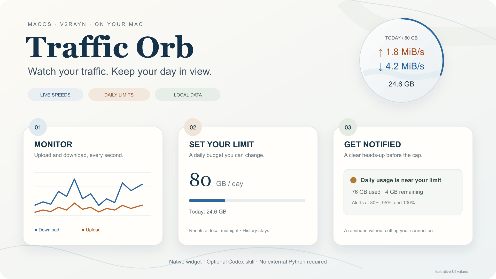
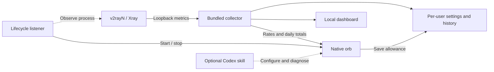

<div align="center">


# Traffic Orb

**Live speeds, daily usage and quota reminders—in a small orb on your Mac.**

[简体中文](README.md) · **English**

[](https://github.com/yunyangge/v2rayn-traffic-orb/releases/latest)
[](#platforms-and-validation)
[](https://github.com/yunyangge/v2rayn-traffic-orb/releases/latest)
[](LICENSE)

macOS · v2rayN / Xray · Native floating widget · Optional Codex skill

</div>

<p align="center">
  
  <br><sub>Monitor → Set a limit → Get notified · Illustrative values, no personal usage data</sub>
</p>

Keep an eye on a download, a video call or a remote-work session without switching back to your proxy client. Traffic Orb shows **upload speed, download speed and today's usage**, then alerts you as your daily allowance fills up. It follows the v2rayN process: quit the client to stop the widget and collector; reopen it to continue tracking the day.

It works with your existing v2rayN/Xray setup. **No server-side panel or VPS changes are needed.** Release packages include the collector runtime, so users do not need Python, Homebrew or a model API key. The included Codex skill is optional.

## Contents

- [Quick start](#quick-start)
- [Everyday controls](#everyday-controls)
- [Daily limits and alerts](#daily-limits-and-alerts)
- [Proxy traffic protection](#proxy-traffic-protection)
- [Configure with Codex](#configure-with-codex)
- [Features](#features)
- [How it works and where data lives](#how-it-works-and-where-data-lives)
- [Platforms and validation](#platforms-and-validation)
- [Repository map](#repository-map)
- [FAQ](#faq)
- [Development and contributions](#development-and-contributions)

## Quick start

### 1. Prepare v2rayN

Install and configure [v2rayN](https://github.com/2dust/v2rayN), confirm your node connects, and use the **Xray core**. Enable traffic statistics and real-time speed in v2rayN's settings, then restart its service. Setting names may differ between releases.

The orb reads Xray's local metrics interface. If metrics are disabled, the client is stopped or the active core is unsupported, it shows a waiting state.

### 2. Download and install

Choose a package from the [latest release](https://github.com/yunyangge/v2rayn-traffic-orb/releases/latest).

| Mac | Download |
|---|---|
| Apple Silicon, M-series | [TrafficOrb-macOS-arm64-v1.0.1.zip](https://github.com/yunyangge/v2rayn-traffic-orb/releases/download/v1.0.1/TrafficOrb-macOS-arm64-v1.0.1.zip) |
| Intel | No prebuilt attachment yet; [build from source](#development-and-contributions). Not tested on Intel hardware. |

Unzip the package and double-click **`Install.command`**. It installs to `~/Applications/TrafficOrb.app` and registers a per-user lifecycle listener. **No administrator password is required.** Settings and usage live outside the app bundle.

> **First launch:** the package is ad-hoc signed and has not been notarized with an Apple Developer ID. macOS may block its first launch. Verify the download source and the supplied SHA-256, then use the system's normal “Open Anyway” flow if appropriate. The installer does not disable Gatekeeper or remove quarantine attributes.

### 3. Open the client and set an allowance

Open v2rayN. The orb appears near the top-right corner of the desktop; drag it to reposition.

- **Orange ↑**: proxy upload speed.
- **Blue ↓**: proxy download speed.
- **Bottom value**: today's proxy upload + download.
- **Outer ring**: progress toward the daily allowance.

Right-click → **设置每日限额 / Set daily limit** → enter a GB value → save. The default is **80 GB/day**. Changes apply immediately and persist across restarts. Option-click the orb or choose the alert-preview action to try a reminder.

## Everyday controls

The `main` branch includes the proxy guard described below (v1.1.0, unreleased). Existing v1.0.1 downloads only provide daily reminders; build from source to use the new feature.

| Action | Result |
|---|---|
| Drag | Reposition and remember the location |
| Double-click | Open the [local dashboard](http://127.0.0.1:18863/): rates, today's upload/download and remaining allowance |
| Right-click | Open a separate menu panel that fits within the display |
| Set daily limit | Save a new allowance; invalid values are rejected |
| Proxy traffic protection | Opt into per-workload termination and set the rolling-hour proxy budget |
| Return to top-right | Restore the default position |
| Hide | Hide the orb while its process and collector keep running; restore it from the menu-bar waveform icon |
| Preview alert / Option-click | Show sample values without changing usage or consuming real alert thresholds |
| Esc / menu × | Dismiss the menu |
| Quit the v2rayN process | Stop the widget and collector; reopen the client to resume |

Closing the v2rayN window may leave its process running. Manually quitting the orb does not force it to reopen during the same client session; it returns on the next v2rayN launch. You can also reopen `~/Applications/TrafficOrb.app` yourself.

## Daily limits and alerts

The allowance counts **proxy upload + download**. Direct traffic is reported separately and does not consume this proxy allowance.

| Alert | Threshold | With the default 80 GB limit |
|---|---:|---:|
| Approaching the limit | 80% | 64 GB |
| Nearly used up | 95% | 76 GB |
| Reached or exceeded | 100% | 80 GB |

Each level alerts once per day. Restarting the app does not repeat an acknowledged level; changing the limit evaluates the new allowance. **This is a reminder, not a bandwidth limiter or automatic disconnect.**

- **New day:** uses the Mac's local calendar and starts a new counter at midnight; past days remain saved.
- **Units:** decimal GB for allowance (`1 GB = 1,000,000,000 bytes`); B/s, KiB/s and MiB/s for speeds.
- **Starting point:** the first time this tool collects data. Earlier usage cannot be reconstructed.
- **Alert availability:** the orb process must be running. Hiding it is fine; quitting it stops pop-up reminders.

Short sample intervals spanning midnight are divided proportionally between days. After a long collection gap, exact usage per day cannot be reconstructed. The last unsampled interval before an Xray restart may also be lost. These figures are for monitoring and can differ from network-interface, VPS or provider billing counters.

## Proxy traffic protection

Right-click the orb → **代理大流量保护 / Proxy traffic protection**. Public installations default to **off**. Once enabled, the default is **5 GB of proxy upload + download per workload over any rolling hour**. Multiple instances of the same script share a budget.

Enable **Xray file logging / LogEnabled** in v2rayN first, then restart its core as required so its generated configuration points to a valid `log.access` file. Traffic Orb does not edit nodes, routing or logging settings. Missing routing evidence is shown in the settings panel and disables enforcement.

- Only connections classified as `proxy*` in Xray's access log count. Ordinary direct traffic and traffic routed through Xray's `direct` outbound do not count.
- At the threshold, the guard terminates the current user's source process and its children, escalating if necessary. Saved files are preserved; unsaved application work can be lost.
- For one hour after triggering, renewed proxy use by that workload is terminated again. A direct-only restart remains allowed. The guard does not shut down Xray or v2rayN.
- Accounting starts when monitoring begins and restores saved rolling history after a restart. Short-lived connections, sampling gaps and delayed log writes can be missed. This is not a zero-overshoot firewall or a billing limit.
- While v2rayN runs, protection continues after closing the orb. The lifecycle helper stops it when v2rayN exits. Disable it at any time in the settings panel.

Daily quota reminders remain independent. Guard events stay local. Xray access logs can contain destination domains; do not attach full logs to public issues.

## Configure with Codex

The app runs independently. The optional skill gives Codex the paths, accounting rules and operational boundaries needed to help with installation, settings and diagnosis.

Double-click **`Install-Skill.command`** in the release package, then restart Codex or open a new chat. It installs to `$CODEX_HOME/skills/traffic-orb`, or `~/.codex/skills/traffic-orb` when `CODEX_HOME` is unset.

| Task | Example prompt |
|---|---|
| Install and check | “Use $traffic-orb to install the widget and check the local statistics connection.” |
| Change allowance | “Set my daily proxy allowance to 100 GB and preserve existing usage.” |
| Diagnose waiting state | “The orb keeps waiting for a connection. Check v2rayN's statistics settings.” |
| Understand counters | “Explain what today's proxy and direct usage include.” |
| Uninstall safely | “Uninstall Traffic Orb but keep my settings and usage history.” |

No additional model service is added to the app. The skill does not automatically upload logs or modify VPN nodes or servers. Its installer will not overwrite an existing skill of the same name; keep a backup before updating. Read the [skill entrypoint](skills/traffic-orb/SKILL.md) directly if needed.

## Features

| Capability | Behavior |
|---|---|
| Live rates | One-second samples; orange upload and blue download |
| Native widget | Light translucent background, draggable position and menu-bar access |
| Daily accounting | Upload, download, total, remaining allowance and date-based storage |
| Configurable quota | 0.1–1,000,000 GB, editable in the UI |
| Alerts | Pop-ups and sound at 80%, 95%, 100%, deduplicated per day |
| Dashboard | Last 60 seconds of rates; proxy and direct traffic shown separately |
| Client lifecycle | Follows v2rayN startup and exit |
| Automatic recovery | Reuses working metrics when generated configuration disappears, or rediscovers loopback listeners belonging to the running Xray process |
| Packaged runtime | Users do not need an external Python installation |
| AI assistance | Optional self-contained Codex skill |
| Persistent data | Settings and history stored separately from the app |

## How it works and where data lives



The collector first locates Xray's metrics port in the current user's v2rayN configuration. If the generated file is missing, it discovers loopback listeners belonging to the running v2rayN/Xray process. It reads `/debug/vars`, and extracts byte counters for `proxy*` and `direct` outbounds. It does not forward proxy traffic, deploy VPS services or copy node settings into its own configuration.

The dashboard listens only on **`127.0.0.1:18863`** and checks the request Host. No external telemetry is provided. Release packages contain no user's node addresses, UUIDs, passwords, subscriptions, logs or historical traffic.

| Location | Purpose |
|---|---|
| `~/Applications/TrafficOrb.app` | App, listener and standalone collector |
| `~/Library/Application Support/TrafficOrb/settings.json` | Allowance and alert thresholds |
| `~/Library/Application Support/TrafficOrb/data/usage.json` | Usage grouped by date |
| `~/Library/Application Support/TrafficOrb/proxy-guard-settings.json` | Proxy protection switch and hourly threshold |
| `~/Library/Application Support/TrafficOrb/data/proxy-guard/` | Rolling counts, status and termination events |
| `~/Library/LaunchAgents/app.trafficorb.lifecycle.plist` | Per-user lifecycle registration |
| `~/.codex/skills/traffic-orb` | Optional skill; overridden by `CODEX_HOME` |

## Platforms and validation

| Area | Current status |
|---|---|
| Apple Silicon / arm64 | v1.0.1 package available; local build and standalone runtime checks passed |
| Intel / x86_64 | Build path provided; no release attachment or real-hardware validation yet |
| Minimum macOS | Deployment target is macOS 13; local validation ran on macOS 26.6 |
| Counters, date boundaries and quotas | 17 Python unit tests passed (including proxy protection) |
| Standalone collector | End-to-end test with simulated Xray metrics; no real VPN required |
| Install, uninstall and retention | Isolated filesystem checks passed; launchd calls were mocked |
| Native menu, saving and reminders | Exercised through the local prototype's actual UI |
| Dual-architecture cloud CI | Workflow provided; no successful hosted build recorded yet |
| Apple notarization | Not provided |

[Validation record](VALIDATION.md) · [Build workflow](.github/workflows/build.yml) · [Development and diagnosis](docs/development.md)

Only common v2rayN **Xray** metrics formats are supported. sing-box, custom configuration locations or different versions may require adaptation. A disconnected state does not mean zero usage.

## Repository map

```text
v2rayn-traffic-orb/
├── README.md / README.en.md       Chinese and English homepages
├── assets/                       Logo and illustrative feature diagram
├── src/
│   ├── TrafficOrb.swift          Orb, menu, allowance UI and alerts
│   ├── collector.py              Counters and daily persistence
│   ├── LifecycleWatcher.swift    v2rayN lifecycle linkage
│   └── Paths.swift               Per-user runtime locations
├── resources/                    Default settings and local dashboard
├── packaging/                    App metadata and launchable installers
├── scripts/                      Build, install, uninstall and privacy checks
├── skills/traffic-orb/            Self-contained Codex skill
├── tests/                        Unit and frozen-collector tests
├── docs/development.md           Components, test variables and release rules
└── VALIDATION.md                 Verified behavior and remaining limits
```

## FAQ

### Why is the orb missing or waiting for a connection?

Check that v2rayN is running with Xray and has statistics / real-time speed enabled. Restart its service. You can also run:

```sh
~/Applications/TrafficOrb.app/Contents/MacOS/TrafficOrbCollector --diagnose
```

This prints state such as configuration availability and enabled metrics, without node credentials. See the [development guide](docs/development.md) for custom paths and ports.

### Will it change my proxy, nodes or VPS?

No. The installer manages this app and its lifecycle listener. Your existing client still handles the proxy connection, and you must provide a working node yourself.

### Does the limit disconnect me? Are monthly limits supported?

The daily quota only triggers reminders. Separately enabling proxy traffic protection terminates over-budget workloads. The UI currently focuses on daily allowance and usage; there is no monthly quota setting. Date-based records are stored locally.

### Does midnight erase past usage?

No. The display switches to the new day's counters; previous dates remain saved. Usage before the tool started collecting cannot be recovered.

### Does closing the dashboard or hiding the orb stop collection?

No, as long as the collector is running. A hidden orb can still alert. Quitting the orb process stops pop-up reminders; quitting v2rayN stops the companion processes.

### How do I upgrade or uninstall?

Run the new package's `Install.command`. The previous app is kept as `TrafficOrb.app.previous`; if that backup already exists, move it elsewhere before upgrading. Settings and usage stay in place.

`Uninstall.command` stops this tool, removes the listener registration and moves the app to Trash. It preserves settings and history by default and does not quit v2rayN.

## Development and contributions

Running a release does not require developer tools. Building from source requires macOS, a matching Swift / Xcode Command Line Tools SDK and Python 3.9+:

```sh
git clone https://github.com/yunyangge/v2rayn-traffic-orb.git
cd v2rayn-traffic-orb
python3 -m venv .venv
.venv/bin/pip install -r requirements-build.txt
.venv/bin/python -m unittest discover -s tests -v
BUILD_PYTHON="$PWD/.venv/bin/python" bash scripts/build.sh
```

Outputs go to `dist/`, including the ZIP and SHA-256. The build checks the bundled runtime, simulated metrics and package contents. Use `SDKROOT` to select an installed matching SDK if needed. Keep real VPN settings and user data out of tests and releases.

For bug reports, provide macOS version, chip type, v2rayN version, core and reproduction steps. **Do not upload node addresses, UUIDs, passwords, subscriptions or full configuration files.** Keep capability and validation statements aligned across both READMEs.

The homepage's reading order draws on [OverleafSkill](https://github.com/yunyangge/OverleafSkill). Illustrations and content reflect Traffic Orb's own capabilities.

[Changelog](CHANGELOG.md) · [Licensing scope](docs/licensing.md)

MIT licensed. Bundled runtime notices are in [THIRD_PARTY_NOTICES.md](THIRD_PARTY_NOTICES.md). Independent community project; not affiliated with v2rayN, Xray, Apple or OpenAI.
