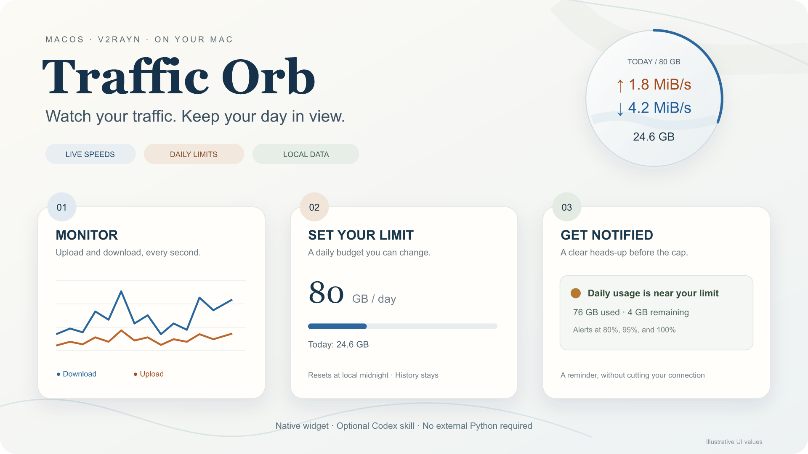
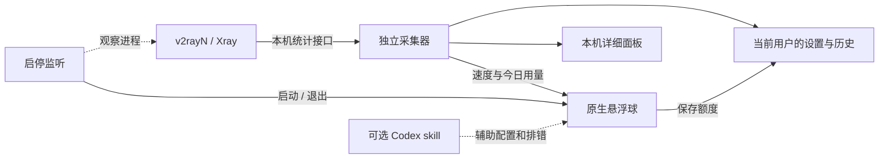

<div align="center">


# Traffic Orb

**把实时网速、今日用量和限额提醒，放进 Mac 右上角的一颗小球。**

**简体中文** · [English](README.en.md)

[](https://github.com/yunyangge/v2rayn-traffic-orb/releases/latest)
[](#平台与验证)
[](https://github.com/yunyangge/v2rayn-traffic-orb/releases/latest)
[](LICENSE)

macOS · v2rayN / Xray · 原生悬浮组件 · 可选 Codex skill

</div>

<p align="center">
  
  <br><sub>看速度 → 设限额 → 收到提醒 · 展示图为示意数据，不含个人使用记录</sub>
</p>

下载文件、视频通话或远程工作时，不用反复切回代理客户端。Traffic Orb 持续显示 **↑ 上传、↓ 下载、今日累计用量**；快到每日额度时，用弹窗和提示音提醒你。关闭 v2rayN 后，它会跟着退出；下次打开时继续按当天记录累计。

它使用你已经配置好的 v2rayN/Xray，**无需部署服务端面板，也无需修改 VPS**。发布包内置采集器，日常使用不需要 Python、Homebrew 或模型 API Key。想让 AI 助手协助配置时，再安装随包附带的 skill。

## 目录

- [快速开始](#快速开始)
- [日常操作](#日常操作)
- [每日限额与提醒](#每日限额与提醒)
- [代理大流量保护](#代理大流量保护)
- [让 Codex 帮你配置](#让-codex-帮你配置)
- [功能一览](#功能一览)
- [工作原理与数据范围](#工作原理与数据范围)
- [平台与验证](#平台与验证)
- [仓库导航](#仓库导航)
- [常见问题](#常见问题)
- [开发与贡献](#开发与贡献)

## 快速开始

### 1. 准备 v2rayN

安装并配置 [v2rayN](https://github.com/2dust/v2rayN)，确认当前节点能正常连接，使用 **Xray 核心**。在 v2rayN 参数设置中开启“流量统计”和“实时速度”，然后重启其服务。不同版本的选项名称可能略有差异。

Traffic Orb 读取 Xray 的本机统计接口。未开启统计、客户端未运行或切换到不支持的核心时，会显示等待连接。

### 2. 下载并安装

从 [最新 Release](https://github.com/yunyangge/v2rayn-traffic-orb/releases/latest) 下载与你的 Mac 匹配的安装包。

| 你的 Mac | 下载方式 |
|---|---|
| Apple Silicon，M 系列芯片 | [TrafficOrb-macOS-arm64-v1.0.1.zip](https://github.com/yunyangge/v2rayn-traffic-orb/releases/download/v1.0.1/TrafficOrb-macOS-arm64-v1.0.1.zip) |
| Intel | 当前没有预编译附件；可按[源码构建](#开发与贡献)说明自行构建，尚未完成 Intel 实机验证 |

解压 ZIP，双击 **`Install.command`**。安装器把 App 放到 `~/Applications/TrafficOrb.app`，并配置当前用户的启停监听，**无需管理员密码**。已有设置和流量记录保存在 App 之外，升级不会主动清空它们。

> **首次打开提示**：当前安装包使用 ad-hoc 签名，尚未经过 Apple Developer ID 公证。macOS 可能阻止首次运行；确认下载来自本仓库，并核对 Release 附带的 SHA-256 后，按系统提供的“仍要打开”流程操作。安装器不会关闭 Gatekeeper 或移除隔离属性。

### 3. 看见悬浮球，设置你的额度

打开 v2rayN。悬浮球默认出现在桌面右上角，可拖动到合适位置。

- **橙色 ↑**：代理上传速度。
- **蓝色 ↓**：代理下载速度。
- **底部数字**：今日代理上传与下载总量。
- **圆环**：今日额度的使用进度。

右键悬浮球 → **设置每日限额** → 输入 GB 数值 → 保存。默认 **80 GB/天**；设置立即生效，重启后保留。按住 Option 单击悬浮球，或选择“测试限额提醒”，可以预览提醒效果。

## 日常操作

`main` 分支已加入下述代理保护功能（v1.1.0，待发布）；现有 v1.0.1 下载包仍只包含每日提醒。需要新功能时请从源码构建。

| 操作 | 结果 |
|---|---|
| 拖动悬浮球 | 移动位置，并记住位置 |
| 双击 | 打开[本机详细面板](http://127.0.0.1:18863/)，查看速度曲线、今日上传/下载和剩余额度 |
| 右键 | 打开独立操作菜单，避免内容挤在小球内部 |
| 右键 → 设置每日限额 | 修改每日 GB 额度；无效数值不会保存 |
| 右键 → 代理大流量保护 | 开关按任务自动终止，并设置滚动一小时的代理流量阈值 |
| 右键 → 回到右上角 | 把组件放回默认位置 |
| 右键 → 隐藏悬浮球 | 暂时隐藏，进程和采集仍运行；可从菜单栏波形图标恢复 |
| 右键 → 测试限额提醒 / Option + 单击 | 显示模拟提醒，不改实际用量、不消耗当天提醒次数 |
| Esc / 菜单右上角 × | 关闭操作菜单 |
| 退出 v2rayN 进程 | 悬浮球与采集器跟随退出；下次启动恢复 |

仅关闭 v2rayN 的窗口，可能仍保留后台进程。手动退出悬浮球后，本次 v2rayN 会话不会强制重新显示；下次启动 v2rayN 时恢复。需要立即重新打开时，运行 `~/Applications/TrafficOrb.app`。

## 每日限额与提醒

额度统计的是 **经过代理出口的上传 + 下载**，直连流量在详细面板另列，不占用这里的代理额度。

| 提醒阶段 | 比例 | 默认 80 GB 时 |
|---|---:|---:|
| 接近限额 | 80% | 64 GB |
| 即将用尽 | 95% | 76 GB |
| 达到或超过限额 | 100% | 80 GB |

每个阶段每天提醒一次。重启 App 不会重复弹出已经提醒过的同一档位；修改限额后按新额度判断。**提醒不会断开网络，也不是流量强制限速器。**

- **每天重新计数**：按 Mac 本地日期，在 00:00 开始新一天；历史记录保留。
- **计量单位**：额度使用十进制 GB，`1 GB = 1,000,000,000 字节`；速度使用 B/s、KiB/s、MiB/s。
- **起算时间**：从首次运行本工具开始，无法补回之前没有采集的流量。
- **提醒条件**：悬浮球进程需要保持运行；隐藏小球仍可提醒，退出进程后不会弹窗。

短采样间隔跨过午夜时，按时间比例分配到两天。长时间停止采集后，无法精确还原停机期间的各日用量；Xray 重启前最后一小段未被采样的数据也可能遗漏。这些统计适合观察使用情况，不应作为运营商或服务器计费凭据。

## 代理大流量保护

右键悬浮球 → **代理大流量保护**。公开安装包默认关闭；主动勾选开启后，默认对同一应用或脚本统计 **任意滚动一小时的代理上传 + 下载，阈值为 5 GB**。同一脚本的多个进程合并计算。

先在 v2rayN 中开启 **Xray 文件日志 / LogEnabled**，按客户端要求重启核心，让配置中存在有效的 `log.access` 文件。Traffic Orb 不会替你修改节点、路由或日志设置；缺少路由记录时，设置页显示异常并暂停自动终止。

- 仅统计 Xray 路由记录判定为 `proxy*` 的连接；普通直连，以及进入 v2rayN 后走 `direct` 的连接，均不计入。
- 达到阈值后，向当前用户的来源进程及子进程发送终止信号，必要时强制结束。已保存文件不删除，但应用尚未保存的工作可能丢失。
- 触发后一小时内，同一任务再次使用代理会被拦截；仅做直连的重启不会被拦截。此功能不关闭整个 Xray 或 v2rayN。
- 保护从开始监控后计数，重启可恢复已保存的滚动记录；短于采样间隔的连接、采样空档及尚未写出的日志可能导致遗漏。这不是零超额的防火墙或运营商计费限制。
- 退出悬浮球后，v2rayN 仍在运行时后台保护继续；退出 v2rayN 则由启停监听停止守卫。可在设置中随时关闭保护。

每日额度提醒与这项自动终止保护相互独立。设置页显示路由识别状态，触发事件保存在本机；Xray 访问日志可能包含目标域名，请不要把完整日志上传到公开 Issue。

## 让 Codex 帮你配置

App 可以独立使用。安装 skill 后，Codex 能了解本工具的路径、统计口径和操作边界，协助安装、调整额度与排错。

在解压的发布包中双击 **`Install-Skill.command`**，然后重启 Codex 或开启新会话。默认安装到 `$CODEX_HOME/skills/traffic-orb`，未设置时为 `~/.codex/skills/traffic-orb`。

| 想做的事情 | 可以对助手说 |
|---|---|
| 安装与检查 | “使用 $traffic-orb 安装流量球，并确认本机统计接口可用。” |
| 修改额度 | “把我的每日代理额度改为 100 GB，保留已有统计。” |
| 处理等待连接 | “流量球一直显示等待连接，帮我检查 v2rayN 的统计设置。” |
| 解释数字 | “解释今天的代理用量和直连流量分别包含什么。” |
| 安全卸载 | “卸载 Traffic Orb，但保留设置和历史记录。” |

skill 不需要新的模型服务，不会给 App 增加外部上传；它也不会自动修改 VPN 节点或服务器。安装器不会覆盖已有同名 skill，请先保留旧版本再更新。操作指南可直接查看 [`SKILL.md`](skills/traffic-orb/SKILL.md)。

## 功能一览

| 能力 | 已提供的行为 |
|---|---|
| 实时速度 | 每秒采样，上传橙色、下载蓝色 |
| 原生悬浮组件 | 浅色半透明背景、拖动定位、菜单栏入口 |
| 今日统计 | 上传、下载、总用量、剩余额度；按本地日期分组 |
| 每日限额 | 0.1～1,000,000 GB，可直接在界面修改并保存 |
| 分级预警 | 80% / 95% / 100% 弹窗和提示音，按天去重 |
| 详细面板 | 最近 60 秒速度曲线，代理与直连分开显示 |
| 启停联动 | 监听 v2rayN 进程，跟随启动和退出 |
| 自动恢复采集 | 临时配置缺失时继续使用有效接口，必要时从运行中的 Xray 重新发现本机统计端口 |
| 便携安装 | App 内置采集器，不要求接收者安装 Python |
| AI 辅助 | 可选 Codex skill，支持配置与诊断 |
| 数据保留 | 设置与历史存放在用户目录，不放在 App 包内 |

## 工作原理与数据范围



采集器优先从当前用户的 v2rayN 配置中定位 Xray 统计端口；临时配置文件缺失时，从正在运行的 v2rayN/Xray 进程的回环监听端口中发现接口，读取 `/debug/vars`，提取 `proxy*` 和 `direct` 出口字节计数。它不转发你的代理连接，不部署 VPS 服务，也不把节点设置复制成自己的配置。

本机页面仅监听 **`127.0.0.1:18863`**，并检查请求的 Host。程序不提供外部遥测；发布包不携带任何人的节点地址、UUID、密码、订阅、日志或历史流量。

| 文件或目录 | 用途 |
|---|---|
| `~/Applications/TrafficOrb.app` | App、启停监听与独立采集器 |
| `~/Library/Application Support/TrafficOrb/settings.json` | 每日额度和提醒比例 |
| `~/Library/Application Support/TrafficOrb/data/usage.json` | 按日期保存的统计记录 |
| `~/Library/Application Support/TrafficOrb/proxy-guard-settings.json` | 代理保护开关与每小时阈值 |
| `~/Library/Application Support/TrafficOrb/data/proxy-guard/` | 滚动计数、运行状态与终止记录 |
| `~/Library/LaunchAgents/app.trafficorb.lifecycle.plist` | 当前用户的启停监听配置 |
| `~/.codex/skills/traffic-orb` | 可选 skill；`CODEX_HOME` 可覆盖默认位置 |

## 平台与验证

| 项目 | 当前状态 |
|---|---|
| Apple Silicon / arm64 | 已提供 v1.0.1 安装包；本地构建、独立运行时测试通过 |
| Intel / x86_64 | 提供构建路径，当前无发布附件，尚未实机验证 |
| macOS 最低版本 | 构建目标为 macOS 13；本地验证系统为 macOS 26.6 |
| 计数、跨天与额度计算 | 17 项 Python 单元测试通过（含代理保护） |
| 独立采集器 | 使用模拟 Xray 指标完成端到端测试，无需真实 VPN |
| 安装、卸载与数据保留 | 隔离目录验证通过；其中 launchd 调用使用替身 |
| 原生菜单、限额保存与提醒 | 同机原型完成实际界面操作验证 |
| 云端双架构 CI | 工作流已提供，当前尚无成功的云端构建记录 |
| Apple 公证 | 尚未提供 |

[详细验证与限制](VALIDATION.md) · [构建工作流](.github/workflows/build.yml) · [开发与排错](docs/development.md)

目前仅支持常见 v2rayN **Xray** 统计格式。使用 sing-box、自定义配置目录或不同版本时，可能需要适配；未连接不能解释为零用量。真实使用统计可能与网卡、VPS 或服务商账单不同。

## 仓库导航

```text
v2rayn-traffic-orb/
├── README.md / README.en.md       中英文项目首页
├── assets/                       Logo 与功能示意图
├── src/
│   ├── TrafficOrb.swift          悬浮球、菜单、限额设置与提醒
│   ├── collector.py              统计采集与日用量持久化
│   ├── LifecycleWatcher.swift    v2rayN 启停联动
│   └── Paths.swift               用户目录与运行时路径
├── resources/                    默认设置与本机详细面板
├── packaging/                    App 元数据与双击安装入口
├── scripts/                      构建、安装、卸载及隐私检查
├── skills/traffic-orb/            自包含 Codex skill
├── tests/                        计数测试与独立采集器测试
├── docs/development.md           组件、调试变量与发布边界
└── VALIDATION.md                 已验证内容与未验证范围
```

## 常见问题

### 没有悬浮球，或一直显示“等待连接”？

先确认 v2rayN 正在运行、当前使用 Xray，并已开启流量统计 / 实时速度。重启 v2rayN 服务后再检查。还可以运行：

```sh
~/Applications/TrafficOrb.app/Contents/MacOS/TrafficOrbCollector --diagnose
```

诊断只输出配置是否存在、统计是否开启等状态，不打印节点凭据。自定义目录和端口的排查见[开发文档](docs/development.md)。

### 会改变我的代理、节点或 VPS 吗？

不会。安装器配置的是本工具自己的 App 和启停监听；代理仍由现有 v2rayN/Xray 负责。你需要自己准备可用的节点。

### 到达限额会断网吗？能按月统计吗？

每日限额只提醒，不强制断网；另行开启的代理大流量保护会终止超额任务。目前界面以每日额度和当天用量为主，没有月度额度设置；按日期的历史保存在本机文件中。

### 每天清零会不会丢失之前的记录？

不会。新的一天切换显示当天计数，历史日记录仍保留。此前尚未运行本工具时的流量无法恢复。

### 关闭页面或隐藏小球，还会统计吗？

会，只要采集器仍在运行。隐藏小球也不会关闭提醒进程；手动退出悬浮球进程则不再弹窗。退出 v2rayN 会联动停止本工具。

### 怎么升级、卸载？

重新运行新版本的 `Install.command`。旧 App 会保留为 `TrafficOrb.app.previous`，如果该备份已存在，先把它移到其他位置再升级。设置和历史不需要迁移。

运行 `Uninstall.command` 会停止本工具、移除启停监听，并把 App 移到废纸篓；默认保留设置和历史，也不退出你的 v2rayN。

## 开发与贡献

运行已编译发布包不需要开发环境。从源码构建需要 macOS、匹配的 Swift / Xcode Command Line Tools SDK，以及 Python 3.9+：

```sh
git clone https://github.com/yunyangge/v2rayn-traffic-orb.git
cd v2rayn-traffic-orb
python3 -m venv .venv
.venv/bin/pip install -r requirements-build.txt
.venv/bin/python -m unittest discover -s tests -v
BUILD_PYTHON="$PWD/.venv/bin/python" bash scripts/build.sh
```

输出在 `dist/`，包括 ZIP 和 SHA-256。构建过程检查独立运行时、模拟统计接口及分发内容；请勿把真实 VPN 配置或使用数据加入测试和发布包。SDK 不匹配时可用 `SDKROOT` 指定本机已安装的兼容 SDK。

提交问题时请提供 macOS 版本、芯片类型、v2rayN 版本、所用核心和复现步骤。**不要上传节点地址、UUID、密码、订阅链接或完整配置。** 文档改动请保持中英文的功能与验证描述一致。

首页的阅读顺序参考 [OverleafSkill](https://github.com/yunyangge/OverleafSkill)，示意图和内容按 Traffic Orb 的实际功能制作。

[版本更新](CHANGELOG.md) · [许可范围说明](docs/licensing.md)

MIT 许可证。第三方运行时许可见 [THIRD_PARTY_NOTICES.md](THIRD_PARTY_NOTICES.md)。独立社区项目，与 v2rayN、Xray、Apple 或 OpenAI 无隶属关系。
